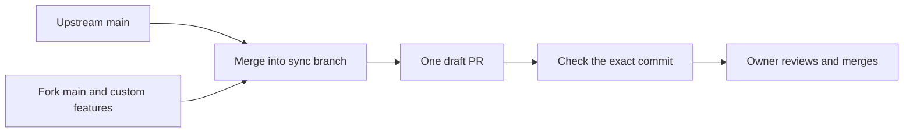

# Keep this fork current

The `Sync T3 upstream` workflow checks `pingdotgg/t3code` main each day at 20:23 UTC.
You can also run it from the Actions tab. Select `main` when you run it.

The workflow uses `gg/sync-t3-upstream` and one PR to fork `main`. It uses normal
Git merges to keep fork changes and previous conflict resolutions. It never
force-pushes, merges the PR, or deploys an app. Reserve this branch for upstream
updates. Keep feature work on separate branches.

## First setup

1. Put this workflow and its scripts on the fork's `main` branch.
2. Enable Actions for the fork. Enable `Sync T3 upstream` only. Keep inherited
   release, deployment, and paid runner workflows disabled until configured.
3. Under Settings, Actions, General, enable **Allow GitHub Actions to create and
   approve pull requests**. GitHub uses one setting for these two permissions.
   This workflow creates PRs. It does not approve them. Keep the default token
   permission read-only. The two PR management jobs request their own write access.
4. Run the workflow once from `main`. No personal access token or repository
   secret is needed. Existing owner review rules and branch gates still apply.

GitHub can disable schedules after 60 days without repository activity. Check the
Actions tab if daily runs stop.

## Review an update

The PR starts in draft. A separate job checks its exact commit with a read-only
token and no repository secrets. It runs the sync integration tests and
`vp run check:changed` against the captured fork `main` commit. This checks affected
code, formatting, types, and nearby tests. It does not run the full upstream CI
suite or prove native apps and release builds work.

Open the workflow link in the PR body to inspect the results. The workflow marks
the PR ready for review only after these checks pass and the PR head and fork
`main` still match the tested commits. The owner must review and merge it.

A token-created PR does not guarantee that ordinary PR checks start automatically.
GitHub can require an owner to approve those workflow runs. This workflow runs
its focused checks directly, so it does not depend on that trigger. Required
checks still need to pass under the fork's existing branch rules. Do not remove
a branch rule to bypass a missing or failing check.

## Handle a stopped update

A conflict fails the run and lists the files in the job summary. An existing PR
stays in draft and its body states that prior validation is stale. The workflow
does not publish a partial merge. Resolve the conflict on the sync branch and
push that resolution. If the branch does not exist yet, create it from fork
`main`, merge upstream `main` into it, resolve the conflict, and push it. Run the
workflow again from `main`.

Failed checks also leave the PR in draft. Fix the sync branch, push the change,
and run the workflow again. If fork `main` changed during checks, rerun to test
the updated merge. A stopped or cancelled run must pass a later run before merge.

If GitHub rejects the bot's branch push or PR creation, the run fails visibly.
Check its error and the Actions permissions. Do not replace the fork with upstream
or use a force push to bypass the error.

GitHub documents the [token trigger rules](https://docs.github.com/en/actions/concepts/security/github_token)
and [repository Actions settings](https://docs.github.com/en/repositories/managing-your-repositorys-settings-and-features/enabling-features-for-your-repository/managing-github-actions-settings-for-your-repository).
